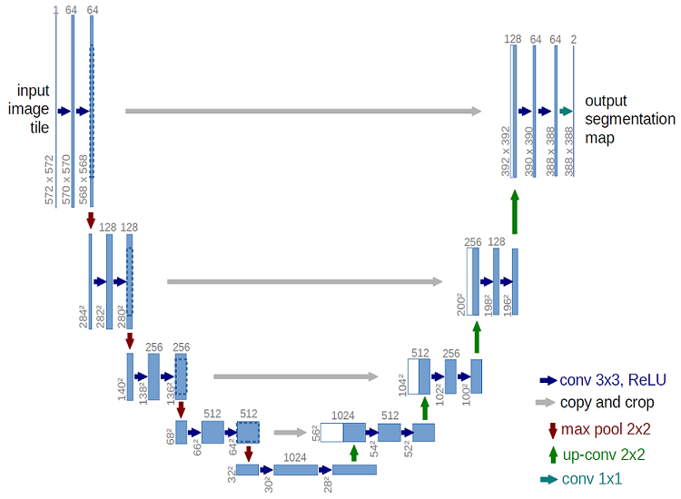
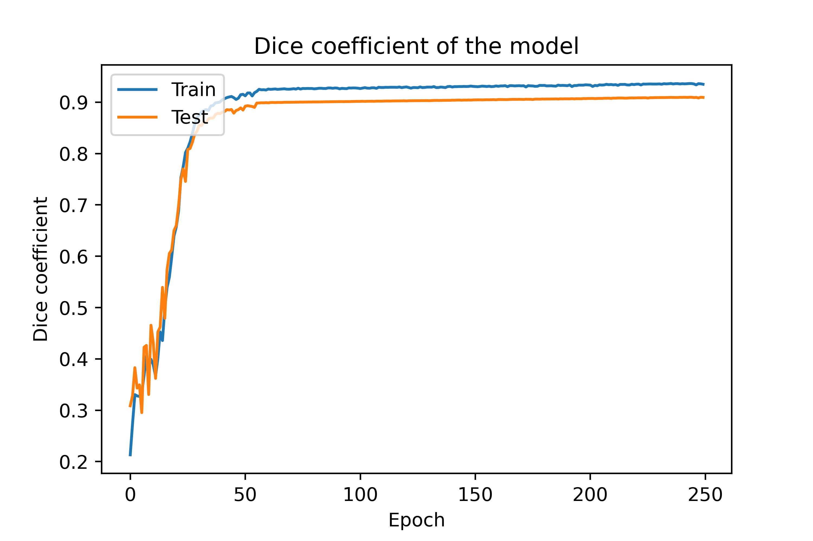
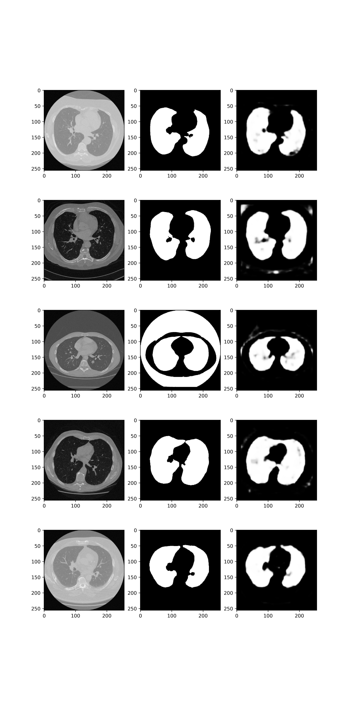

<p align="center">
  
</p>

<h1 align="center">Lung Segmentation from CT Scans</h1>

<p align="center">
  Deep-learning lung segmentation on 2D CT slices with a <b>U-Net</b> and a lightweight <b>shallow CNN</b>, evaluated with the <b>Dice coefficient</b>.
</p>

<p align="center">
  
  
  
  
  
</p>

---

## Table of Contents

- [Overview](#overview)
- [Dataset](#dataset)
- [Models](#models)
- [Results](#results)
- [Project Structure](#project-structure)
- [Getting Started](#getting-started)
- [Usage](#usage)
- [References](#references)

## Overview

Accurately locating the lungs is the first step in any automated pipeline that looks for lesions or disease in chest CT. This project addresses the Kaggle task **[Finding and Measuring Lungs in CT Data](https://www.kaggle.com/datasets/kmader/finding-lungs-in-ct-data)**: given a CT slice, predict a binary mask of the lung region.

**Pipeline**

1. **Preprocess** – load the `.tif` CT slices and manual lung masks, resize them to `256 × 256`, normalize the masks, and split them 90/10 into training and validation sets.
2. **Train** – fit either a shallow encoder–decoder CNN or a full U-Net with binary cross-entropy loss and the Adam optimizer, reducing the learning rate when progress plateaus.
3. **Evaluate** – track the Dice coefficient on the training and validation sets, then compare predicted masks against the ground truth.

## Dataset

The dataset contains CT images with manually segmented lungs and measurements in 2D and 3D.

| Item | Details |
|---|---|
| Source | [kaggle.com/datasets/kmader/finding-lungs-in-ct-data](https://www.kaggle.com/datasets/kmader/finding-lungs-in-ct-data) |
| Inputs used | `2d_images/*.tif` (CT slices) |
| Targets used | `2d_masks/*.tif` (binary lung masks) |
| Model input size | `256 × 256 × 1` (grayscale) |
| Split | 90% train / 10% validation |

> The raw data is not included in this repository. Download it from Kaggle and place it in `raw_data/` (see [Getting Started](#getting-started)).

## Models

Both models are defined in [`model.py`](model.py) and compiled with Adam (`lr = 1e-3`), binary cross-entropy loss, and the Dice coefficient as a metric.

### 1. Shallow CNN — `shallow_CNN()`

A compact encoder–decoder baseline: three `Conv2D + MaxPooling` blocks (32 → 64 → 128 filters), a dense bottleneck, and three `UpSampling + Conv2D` blocks that end in a sigmoid mask. It trains quickly and is useful for sanity checks.

### 2. U-Net — `unet()`

The classic U-Net of Ronneberger et al. (2015): a four-level contracting path (64 → 512 filters), a 1024-filter bottleneck with dropout, and a symmetric expanding path with **skip connections** that concatenate encoder features into the decoder, which preserves fine boundary detail.

<p align="center">
  
  <br/>
  <em>Figure 1. U-Net architecture.</em>
</p>

### Evaluation metric

The **Dice coefficient** measures the overlap between the predicted mask *P* and the ground-truth mask *G*:

$$
\text{Dice}(P, G) = \frac{2\,|P \cap G|}{|P| + |G|}
$$

A score of 1 means a perfect match. It is implemented in [`util.py`](util.py).

## Results

### Training curve

<p align="center">
  
  <br/>
  <em>Figure 2. Training and validation Dice coefficient per epoch.</em>
</p>

### Qualitative predictions

Each row shows the input CT slice, the ground-truth mask, and the predicted mask.

<p align="center">
  
  <br/>
  <em>Figure 3. CT input, ground truth, and model prediction.</em>
</p>

## Project Structure

```
Image_Segmentation/
├── raw_data/              # Place the Kaggle .tif data here (2d_images/, 2d_masks/)
├── dataset/               # Preprocessed NumPy arrays (x_train, y_train, x_val, y_val)
├── docs/                  # Figures used in this README
├── preprocess.py          # Loads, resizes, normalizes, and splits the data
├── model.py               # Shallow CNN and U-Net definitions
├── util.py                # Dice coefficient metric
├── train.ipynb            # Training, evaluation plots, and predictions
└── README.md
```

## Getting Started

### Prerequisites

- Python 3.x
- TensorFlow 2.x / Keras
- NumPy, SciPy, Matplotlib
- scikit-image, scikit-learn
- OpenCV (optional)

```bash
pip install tensorflow numpy scipy matplotlib scikit-image scikit-learn opencv-python
```

> **Note:** The code uses older Keras APIs (e.g. `keras.layers.normalization` and `Adam(lr=...)`). On recent TensorFlow releases, change these to `tensorflow.keras.layers.BatchNormalization` and `Adam(learning_rate=...)`.

### Installation

```bash
git clone https://github.com/rezatorabi13/Image_Segmentation.git
cd Image_Segmentation
```

### Data setup

1. Download the dataset from [Kaggle](https://www.kaggle.com/datasets/kmader/finding-lungs-in-ct-data).
2. Unzip it into `raw_data/` so that the layout is:

```
raw_data/
├── 2d_images/*.tif
└── 2d_masks/*.tif
```

## Usage

**1. Preprocess the data.** This writes the training and validation arrays to `dataset/`.

```bash
python preprocess.py
```

**2. Train a model.** Open [`train.ipynb`](train.ipynb) and choose one model:

```python
model = shallow_CNN(Inpute_shape=(256, 256, 1))   # fast baseline
# model = unet(input_size=(256, 256, 1))          # full U-Net
```

Then run the notebook. It trains the model, saves the Dice and loss curves (`Dice_coeficient.jpg`, `loss.jpg`), and plots the predictions on the validation set.

**3. Tune.** Adjust `epochs`, `batch_size`, and the `ReduceLROnPlateau` settings in the notebook as needed. For more detail, see the comments in each script.

## References

- O. Ronneberger, P. Fischer, T. Brox. *U-Net: Convolutional Networks for Biomedical Image Segmentation.* MICCAI 2015. [arXiv:1505.04597](https://arxiv.org/abs/1505.04597)
- K. Mader. *Finding and Measuring Lungs in CT Data.* Kaggle. [Dataset link](https://www.kaggle.com/datasets/kmader/finding-lungs-in-ct-data)

---

<p align="center">
  If you find this project useful, please consider giving it a ⭐
</p>
